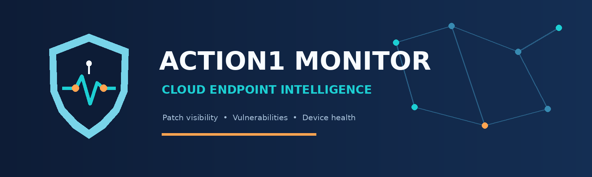

# Action1 Monitor for Home Assistant

[](https://github.com/c-a-r-s-t-e-n/action1-homeassistant/actions/workflows/validate.yml)
[](https://github.com/c-a-r-s-t-e-n/action1-homeassistant/releases)
[](LICENSE)
[](https://www.home-assistant.io/)
[](https://www.home-assistant.io/integrations/marketplace/)
[](https://github.com/c-a-r-s-t-e-n/action1-homeassistant/issues)

**Monitor Action1-managed endpoints, patch exposure and cloud security reporting directly in Home Assistant.** This independent community integration uses the official Action1 REST API. No local access, public endpoint address or VPN connection is required.

| Endpoint health | Patching and security | Organization visibility |
|---|---|---|
| Cloud online status, last contact, pending restart | Missing update totals, CVSS severity, CISA KEV | Devices, groups, usage and licenses |
| OS, CPU, agent, hardware diagnostics | Per-organization CVE catalog with explicit coverage | Automation history, software report counts, audit totals |
| Distinguish offline from unknown status | Unknown and incomplete security reports never become zero | Separate enterprise and organization entities |

> **Important:** Security and patch data are *periodically refreshed cloud reports*, not real-time endpoint scans. Some Action1 reports are tenant- or permission-dependent. Never use this integration as the sole authority for patch compliance, vulnerability remediation, emergency alerts or cybersecurity response.

## Requirements

- **Home Assistant 2025.1 or newer** is the declared compatibility baseline; older supported versions have not all been tested. The built-in **Marketplace** starts with Home Assistant **2026.11**. On older installations, use HACS where supported.
- Action1 account with REST API access and a **Client ID** and **Client Secret**, preferably dedicated to monitoring and limited to the necessary organizations.
- Outbound HTTPS access to your selected Action1 cloud region.

<!-- ha-marketplace:exclude-start -->
## Install

[](https://my.home-assistant.io/redirect/hacs_repository/?owner=c-a-r-s-t-e-n&repository=action1-homeassistant&category=integration)

1. Add `https://github.com/c-a-r-s-t-e-n/action1-homeassistant` as a custom **Integration** repository in **Settings → Marketplace** (or HACS → Custom repositories on older installations).
2. Install the latest verified release and **restart Home Assistant** after updates.
3. Go to **Settings → Devices & services → Add integration → Action1 Monitor**.
4. Select your Action1 region and enter your own Client ID and Client Secret.

For a manual install, copy only `custom_components/action1_monitor/` to `/config/custom_components/action1_monitor/` and restart Home Assistant.

[Releases](https://github.com/c-a-r-s-t-e-n/action1-homeassistant/releases) · [Report a bug](https://github.com/c-a-r-s-t-e-n/action1-homeassistant/issues) · [Security](SECURITY.md)
<!-- ha-marketplace:exclude-end -->

## Configuration

Select the cloud region that hosts your Action1 account, including **Europe**, **North America**, **North America 2**, **Australia** and **United Kingdom**. The integration authenticates using OAuth 2.0 and discovers all organizations visible to these credentials. No router, endpoint agent, inbound port, VPN, YAML configuration or webhook is required.

For a region-specific deployment, confirm the API hostname and account permissions in [Action1's official REST API](https://app.action1.com/apidocs/). If no organizations are accessible, Home Assistant displays a setup error rather than creating an empty installation.

## What you get

### Per endpoint

- **Agent connected** — connectivity binary sensor derived from the dedicated `online_status` field. Unrecognized status remains unknown, never assumed offline.
- **Reboot required** — binary sensor derived from the reported `reboot_required` value.
- **Last seen**, **last boot**, agent version/install date, operating system, hardware platform, CPU, memory and manufacturer where Action1 exports suitable scalar values.
- **Missing update records** — exact reported count returned by the endpoint's missing-update API.
- **Missing critical updates** and **Missing other updates** — read from Action1's officially documented extended endpoint fields (`missing_critical_updates`, `missing_other_updates`) when the account returns them with `fields=*`; absent or nonnumeric values remain unknown.
- **Update status**, **vulnerability status** and optional, API-reported per-endpoint summary counts.
- Optional private/hardware diagnostics (serial, last reported user, comment and low-value inventory fields) are **disabled by default**, and may be enabled from the entity's settings.

### Per organization

| Category | Sensor data | Notes |
|---|---|---|
| Device inventory | Managed, online, offline and unknown-state endpoint totals | Inventory refresh about every 5 minutes |
| Patch management | Update catalog item count | Catalog items are not the same as the per-device missing-update count |
| Vulnerability reporting | CVE total; CVSS **critical (9.0+)** and **high (7.0–8.9)**; explicit CISA KEV flags | Severity counts only when the **entire report** was examined |
| Report reliability | CVE detail coverage and count with unavailable severity | Partial reports keep detailed severity sensors unknown |
| Software inventory | Report row count and error count | A row is not necessarily a unique installed application |
| Endpoint groups | Group count | Reflects group permissions |
| Automations | Scheduled automations and execution counts | Read-only; cannot launch or modify automations |
| Infrastructure | Deployment agent count, log count | Aggregated counts, no raw event bodies |
| Subscription usage | Active, inactive and monthly average endpoints | Only present if returned by the API |

### Enterprise

The **Action1 Enterprise** device contains organization count, script-library size, available reports, audit-entry count, licensed/free/actual endpoint numbers, license type/status/expiry, usage summaries and the last detailed report timestamp. Some subscription and usage values may remain unavailable depending on the tenant's permissions.

The integration automatically discovers new organizations and endpoints during normal updates. Existing entity *unique IDs* remain stable after an update.

### Entity IDs and automation discovery

Home Assistant determines visible entity IDs from the device and entity labels. Examples (not fixed identifiers):

```text
binary_sensor.example_pc_agent_connected
binary_sensor.example_pc_reboot_required
sensor.example_pc_missing_update_records
sensor.action1_my_organization_critical_cves_cvss_9
sensor.action1_enterprise_licensed_endpoints
```

Open **Developer tools → States** or **Settings → Devices & services → Action1 Monitor** and copy your real IDs before creating automations. Do not hardcode guessed device names. An entity being unavailable is **not** proof of zero vulnerabilities or zero missing updates.

## When are data refreshed?

| Report type | Default refresh |
|---|---|
| Organizations, endpoints, online status | 5 minutes |
| Up to five per-endpoint missing update totals | Rotating on each 5-minute cycle |
| Organization CVEs, updates, software, groups and automations | About 30 minutes, beginning after the initial inventory refresh |
| Enterprise licensing, usage, audit and script-library totals | About 30 minutes |

Action1 calls are paced at approximately **one request per 2.25 seconds** per integration instance (roughly 27/minute); cloud reporting latency and 429 backoff add delays.

**Performance and data correctness**

- The first setup fetches only organization/endpoint inventory and a bounded set of update totals; expensive cloud reports are delayed to the next cycle.
- Counts use Action1's `total_items` response field whenever available. The integration does not download thousands of script bodies, audit events, patch descriptions or software rows merely to count them.
- CVSS/KEV reports are evaluated with an explicit **1,000-record cap**. If the report is larger or incomplete, CVE totals may still be known but severity breakdowns remain **unknown** rather than misleadingly undercounted.
- Endpoint records use bounded pagination. For very large organizations (over **5,000 endpoints**), additional scale testing is required.
- The coordinator shares requests between entities. Incomplete optional reports do not prevent the core inventory from functioning.
- Outbound connectivity, scope of API credentials and Action1's own reporting schedule may limit freshness.

[Technical field mapping and API limits](docs/API.md) · [Troubleshooting](docs/TROUBLESHOOTING.md)

## Examples

### Alert when a Windows endpoint remains offline

Replace both entity IDs with your own Home Assistant entities and notification target.

```yaml
alias: "Action1 - endpoint offline"
triggers:
  - trigger: state
    entity_id: binary_sensor.REPLACE_WITH_ENDPOINT_AGENT_CONNECTED
    to: "off"
    for: "00:10:00"
actions:
  - action: notify.mobile_app_REPLACE_WITH_YOUR_PHONE
    data:
      title: "Action1: endpoint offline"
      message: >-
        Action1 reports this endpoint as offline.
        Check the last contact timestamp in the device diagnostics.
mode: single
```

### Alert when a restart is required

```yaml
alias: "Action1 - reboot pending"
triggers:
  - trigger: state
    entity_id: binary_sensor.REPLACE_WITH_ENDPOINT_REBOOT_REQUIRED
    to: "on"
    for: "00:30:00"
actions:
  - action: notify.mobile_app_REPLACE_WITH_YOUR_PHONE
    data:
      title: "Action1: Windows restart required"
      message: "A managed endpoint reports that a restart is pending."
mode: single
```

### Build a security dashboard

Use a Home Assistant **Entities** or **Tile** card containing each organization's Managed endpoints, Critical CVEs, High CVEs, Known exploited CVEs, CVE detail coverage and Missing update catalog items. Pair these with per-endpoint Missing update records and Reboot required status. **Do not trigger an all-clear alert when coverage is partial or any security sensor is unavailable.**

## Diagnostics and troubleshooting

Download the built-in **Action1 Monitor diagnostics** from the integration entry if data is missing. Diagnostics contain **counts, report categories, synchronization times and generic error categories**—not raw device identifiers, credentials, endpoint names or script bodies. Never upload raw API responses or Home Assistant private storage to GitHub.

| Symptom | Explanation / action |
|---|---|
| Account connects but no devices appear | Verify organizational access and check Action1's managed endpoint list |
| Connectivity unknown | The tenant's `online_status` value may be unrecognized; do not interpret it as offline |
| CVE total present, severity unknown | Detailed CVE report is too large, incomplete or not yet refreshed |
| Missing update count unknown | Endpoint has not yet been reached by the rotating update-total poll; expanded inventory patch counts may be independent of this report |
| Critical update severity unknown | The endpoint `missing_critical_updates` value is absent or nonnumeric. Organization-wide update catalog severity cannot yet be inferred reliably |
| No software program list | Only report totals are supported; individual program inventory mapping is not validated |
| Marketplace icon missing after update | Restart Home Assistant and allow Marketplace image cache to refresh; verify the tagged release contains `brand/` assets |
| Installation fails or stops updating | Review Home Assistant logs, API permissions and the selected cloud region |

See [full troubleshooting details](docs/TROUBLESHOOTING.md).

## Security, privacy and removal

The integration performs **GET-only monitoring calls**; OAuth token acquisition uses POST. It never deploys software, changes Action1 policies, reboots endpoints, runs scripts or initiates remote actions.

Credentials are stored in Home Assistant's private config-entry storage. Protect Home Assistant, dashboards, logs and backups. API results may contain employee names, software inventory and device identifiers; only required values are exposed as entities, and detailed report caches are reduced to aggregate metadata.

**Update:** Install the desired release through Marketplace or HACS, then restart Home Assistant. Keep the integration entry to preserve credentials, renamed entities and automations.

**Remove:** Delete the integration under **Settings → Devices & services**, uninstall its Marketplace/HACS files, restart Home Assistant, and revoke unused OAuth credentials in Action1. Historical Recorder entries and backups follow your Home Assistant retention policies.

<!-- ha-marketplace:exclude-start -->
## Development and support

The repository contains the Home Assistant integration, tests, documented response mappings, an original reproducible branding system and CI validation. One-off tenant-specific diagnostic PowerShell scripts stay **outside** the public repository.

[Contributing](CONTRIBUTING.md) · [Security policy](SECURITY.md) · [Changelog](CHANGELOG.md) · [Branding](docs/BRANDING.md) · [Action1 API](https://app.action1.com/apidocs/)

CI runs Python unit tests, hassfest and HACS validation. Passing these checks does not replace a live Home Assistant installation test with a real tenant or establish support for every endpoint model and subscription plan.
<!-- ha-marketplace:exclude-end -->

## License and trademarks

Copyright (c) 2026 **c-a-r-s-t-e-n and contributors**. Distributed under the **[MIT License](LICENSE)**.

This is independent community software, **not affiliated with, sponsored by or endorsed by Action1**. All manufacturer and product names are trademarks of their respective owners. The artwork is an original community identity rather than Action1's official corporate logo. Provided **as is**, without warranty.
